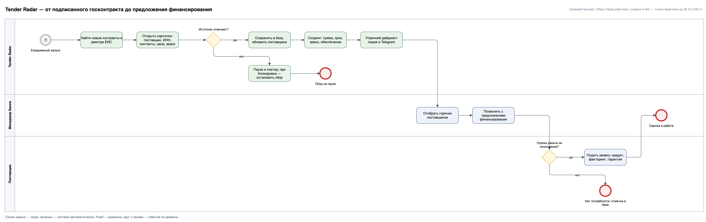

# Tender Radar

**Находить поставщиков по госконтрактам, которым прямо сейчас нужны деньги на исполнение, — в момент подписания контракта.**

Учебная практика, 1-й семестр магистратуры НИЯУ МИФИ (программа Simulative), 2026. **Статус: в работе** — сбор данных идет ежедневно, аналитика и скоринг впереди (план ниже).

## Бизнес-задача

Поставщик по 44-ФЗ почти никогда не получает аванс: оплата приходит после приемки, а закупать материалы и платить людям нужно сразу. Возникает кассовый разрыв, который закрывают банковские продукты — кредит на исполнение госконтракта, факторинг, банковские гарантии. Банку или брокеру нужно найти такого поставщика **в момент подписания контракта**: это единственная точка, где поставщик публично раскрыт вместе с ИНН и контактами.

**Пользователь:** менеджер банка или брокер, продающий финансирование под госконтракты. **Сценарий:** утром получить в Telegram список поставщиков, подписавших контракт накануне, с суммой, сроком и контактами.

**Целевой процесс** — от подписанного контракта до предложения финансирования (сбор и база работают, скоринг и бот — следующие этапы):



## Что уже подтверждено данными (на 30.09.2026)

| Показатель | Значение |
|---|---|
| Собрано контрактов с карточками | 2 661 за 14 дней сбора |
| Доля контрактов без аванса | **94,1 %** — гипотеза о кассовом разрыве подтверждается в каждом дне сбора |
| Суммарная цена контрактов в выборке | 11,5 млрд ₽ |
| Поставщиков в базе | 1 966, у 1 918 есть телефон |

## Что я сделал как аналитик

- **Сформулировал продуктовую гипотезу и пользователя** до написания кода: кто покупает результат, в какой момент, в каком виде ему нужен ответ.
- **Проверил источник данных:** ФТП ЕИС закрыт с 2025 года, SOAP-сервис требует токен с ГОСТ-TLS, протоколы итогов анонимны с 2022 года — единственный рабочий источник с контактами поставщика это публичные HTML-страницы реестра контрактов.
- **Спроектировал модель данных** (контракты, поставщики, связь, журнал запусков) и методику выборки: случайный отбор страниц выдачи вместо первых по порядку, ограничения выборки описаны явно.
- **Заложил бережный режим к источнику:** пауза 2 с между запросами, повторы, остановка сбора при блокировке IP.
- **Построил порядок работ от ценности:** аналитика → скоринг → бот. Бот без скоринга выдавал бы произвольные компании.
- **Собрал прототип на Python** (requests, BeautifulSoup, SQLite) с тестами парсеров на сохраненных страницах и ежедневным запуском по расписанию.

## Что дальше

| Срок | Этап |
|---|---|
| до 15.10 | Аналитический срез: объемы, распределение по регионам, отраслям, суммам, динамика по неделям |
| до 26.10 | Скоринг «горячих» поставщиков: правила из аналитики (сумма, срок исполнения, аванс, обеспечение, повторные победы) |
| до 09.11 | Telegram-бот: `/today`, `/leads`, `/filter`, `/stats`, утренний дайджест |
| декабрь | Защита: презентация и демонстрация бота |

Полный план практики — [docs/plan.md](docs/plan.md), методика — [docs/methodology.md](docs/methodology.md).

---

## Идея

Поставщик, подписавший госконтракт, оказывается в кассовом разрыве: аванс
по 44-ФЗ выплачивается редко (в первой выборке — 3 контракта из 50), оплата
приходит после приемки, а закупать материалы и платить людям нужно сразу.
Это спрос на банковские продукты «кредит на исполнение госконтракта»,
факторинг и банковские гарантии на следующие тендеры.

Момент подписания контракта — единственный момент, когда поставщик
раскрывается публично (в протоколах итогов с 2022 года участники анонимны).
Реестр контрактов ЕИС отдает по каждому контракту поставщика с ИНН,
контактами, цену, аванс, размер обеспечения и сроки исполнения.

Проект собирает эти данные ежедневно и отвечает на вопросы:
кто из поставщиков нуждается в финансировании прямо сейчас, на какую сумму,
в каких регионах и отраслях спрос выше, как он меняется по неделям.

## Источник данных

Публичные HTML-страницы zakupki.gov.ru (информация общедоступна по ст. 4 44-ФЗ):

- поиск по реестру контрактов — `/epz/contract/search/results.html`
- карточка контракта — `/epz/contract/contractCard/common-info.html?reestrNumber=…`

ФТП ЕИС закрыт с 01.01.2025, SOAP-сервис требует токен из личного кабинета
с ГОСТ-TLS, поэтому используется HTML. Запросы идут с паузой 2 с и повторами;
сертификат ЕИС выдан российским УЦ, которого нет в системном хранилище macOS,
поэтому проверка сертификата отключена.

## Запуск

```bash
python3 -m venv .venv && .venv/bin/pip install -r requirements.txt
cd src
../.venv/bin/python -m tender_radar fetch --pages 2 --days 1 --cards   # контракты за сутки + карточки
../.venv/bin/python -m tender_radar stats
```

Данные складываются в `data/tender_radar.db` (SQLite). Ежедневный запуск —
`scripts/run_daily.sh` через cron или launchd (см. комментарий в скрипте).

## Методика

Поиск по одному дню возвращает более 10 000 контрактов; работа ведется на
выборке 150 карточек в сутки (~1,5 % потока), страницы выдачи отбираются
случайно, а не подряд. Ограничения выборки, режим нагрузки на ЕИС и правила
поведения при блокировках описаны в [docs/methodology.md](docs/methodology.md).

## Тесты

```bash
.venv/bin/python tests/test_parsers.py
```

Тесты работают на сохраненных страницах из `tests/fixtures/` и не обращаются к сети.

## Структура

```
src/tender_radar/
  client.py    HTTP-клиент: троттлинг, повторы, сохранение сырого HTML
  parsers.py   разбор поиска и карточки контракта (BeautifulSoup)
  db.py        схема SQLite и запись
  cli.py       команды fetch / stats
scripts/       запуск по расписанию
notebooks/     аналитика по собранным данным
docs/          план практики, артефакты
```

## Схема данных

- `contracts` — контракт: реестровый номер, способ определения поставщика,
  заказчик, цена (или максимальное значение для рамочных), аванс %,
  обеспечение исполнения, даты подписания и исполнения, бюджет, место поставки
- `suppliers` — поставщик: ИНН, КПП, наименование, адрес, телефон, e-mail
- `contract_suppliers` — связь контракт ↔ поставщик
- `fetch_log` — журнал запусков

## Статус технической части

- [x] Проверка источника, прототип парсера, первая выборка
- [x] Ежедневный запуск по расписанию (launchd), 1 640 контрактов за 8 дней
- [x] Тесты парсеров, случайный отбор страниц, обработка блокировок
- [ ] Накопление истории до начала декабря (~10–11 тыс. карточек)
- [ ] Аналитика: срез спроса на финансирование по регионам / отраслям / суммам
- [ ] Скоринг «горячих» поставщиков и выгрузка в Telegram
- [ ] Презентация к защите

## Данные и этика

Используются только общедоступные сведения реестра контрактов (ст. 4 44-ФЗ). База с данными поставщиков в репозиторий не входит. Сбор идет с паузами и останавливается при признаках блокировки.

---

Виктор Чернышев — бизнес- и системный аналитик · Telegram [@cherny_shevv](https://t.me/cherny_shevv)
