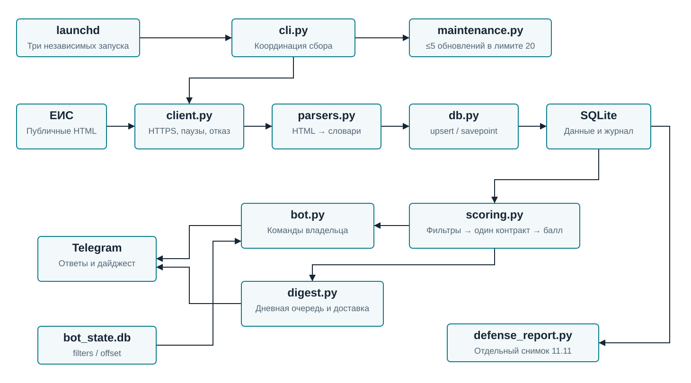
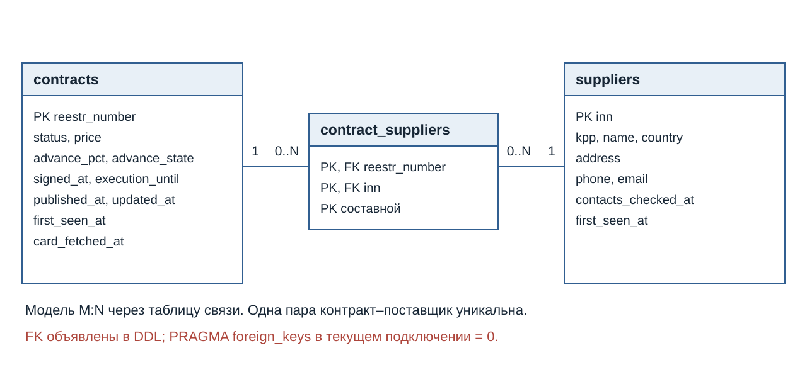

# Техническое устройство Tender Radar

AS IS на 16.11.2026; исходный код закреплен коммитом `e2d0e7afcf32040d4eccc2734f523348ed727bc4`.
Схемы описывают реализованное поведение. BPMN — аналитические модели, не исполняемый движок.

## Карта системы

Ежедневный shell-сценарий, постоянный бот и повтор дневной очереди — три независимых запуска launchd. Команды Telegram читают локальную базу и не обращаются к ЕИС.

- `src/tender_radar/cli.py` — Выбирает команду CLI, собирает параметры, связывает клиент, парсер, базу, рейтинг и доставку.
- `src/tender_radar/client.py` — Получает HTML по HTTPS, проверяет сертификат и имя сайта, выдерживает паузы и ограниченные повторы.
- `src/tender_radar/parsers.py` — BeautifulSoup разбирает поиск и карточки; функции преобразуют деньги, даты, аванс и таблицу поставщиков.
- `src/tender_radar/db.py` — Создает схему, обновляет контракты по реестровому номеру, поставщиков по ИНН и атомарно заменяет связи.
- `src/tender_radar/scoring.py` — SQL ограничивает сумму и аванс, Python проверяет даты и организации, выбирает один контракт и рассчитывает балл.
- `src/tender_radar/bot.py` — Долгий опрос Telegram, проверка владельца, четыре команды по локальной базе и подтверждение offset после обработки.
- `src/tender_radar/bot_state.py` — SQLite key/value хранит регион, минимальную сумму и номер следующего обновления Telegram.
- `src/tender_radar/digest.py` — Отбирает новые лиды, формирует неизменную дневную очередь, отправляет части и сохраняет подтвержденную позицию.
- `src/tender_radar/fetch_status.py` — Файловая блокировка не допускает два основных сборщика, журнал фиксирует success/partial/failed и обнаружение interrupted.
- `src/tender_radar/maintenance.py` — Перепроверяет приоритетные известные карточки и добирает контакты в одном вспомогательном лимите.
- `src/tender_radar/network.py` — Классифицирует DNS, TLS, timeout и HTTP без записи URL с токеном.
- `analysis/defense_report.py` — Читает фиксированный снимок, считает агрегаты, классификацию и чувствительность весов.

## Данные

Контракт и поставщик связаны таблицей contract_suppliers: одна пара уникальна. В основной базе семь таблиц; в отдельной bot_state.db находится таблица state с фильтрами и offset. [Полная схема](er-full.svg).

REFERENCES объявлены в DDL, но текущий способ подключения дает PRAGMA foreign_keys=0. Поэтому схема показывает логические ссылки, а не обещание автоматического контроля всех связей СУБД.

## Процессы

- [Ежедневный сбор и доставка](bpmn-daily.svg), [редактируемая BPMN-модель](daily.bpmn).
- [Повтор сохраненной очереди](bpmn-retry.svg), [BPMN](retry.bpmn).
- [Обработка одного Update](bpmn-command.svg), [BPMN](command.bpmn).

Внутренние циклы загрузки и отправки свернуты. Сплошная стрелка — управление внутри пула; пунктирная — обмен между участниками. Три XML проверены по официальным схемам OMG BPMN 2.0 и на достижимость узлов. Это не проверка исполнения в промышленном BPMN-движке.

## Один контракт от источника до ответа

1. client.py получает HTML с паузами и проверкой HTTPS.
2. parsers.py выделяет поля и различает explicit, inferred_zero и неизвестный аванс.
3. db.py записывает контракт, поставщиков и связи. Успешная карточка фиксируется; незавершенная запись откатывается при закрытии.
4. scoring.py объединяет таблицы SQL-запросом и применяет правила Python. Свежесть, контакт и настройки проверяются до выбора крупнейшего подходящего контракта на ИНН.
5. Сумма, срок, свежесть и активность нормируются; веса 45/25/20/10 дают объяснимый балл.
6. bot.py отвечает владельцу; digest.py сохраняет дневные сообщения в outbox до отправки и продолжает с подтвержденной позиции.

## Аналитика и границы

Снимок 11.11: 6 203 контракта, 4 129 поставщиков, 2 990 с почтой. 5 814 принятых нулевых авансов — 93,73% известных значений. Доля включает допущение нуля при отсутствии поля на узнаваемой карточке. Это не доля явно напечатанных нулей и не оценка всего рынка.

Воспроизводимость: analysis/defense_report.py и analysis/defense-2026-11-11.json. SQL извлекает и связывает строки; Python считает агрегаты, эвристики и чувствительность. Снимок читается отдельно от изменяющейся рабочей базы.

Правила ранжирования не доказывают спрос, кредитоспособность или конверсию. Меток сделок и обучения ML нет. Код создавался с существенной помощью Claude Code и Codex; LLM в рабочем скоринге не используется. После неопределенного подтверждения Telegram возможен дубль; промышленный SLA не заявляется.

## Проверка материалов

15 технических слайдов (10 основных и 5 приложений), пособие на 16 страниц и автономный HTML-атлас подготовлены для обучения и защиты. Атлас содержит 12 модулей, каталог 90 функций и методов, 10 подробных разборов, ER/BPMN и учебный калькулятор. Он не подключается к рабочей базе или Telegram. Первый прогон доклада по таймеру и мок-защита еще предстоят.

Официальные основания нотации: [OMG BPMN 2.0.2](https://www.omg.org/spec/BPMN/2.0.2/), [внешние ключи SQLite](https://www.sqlite.org/foreignkeys.html).
